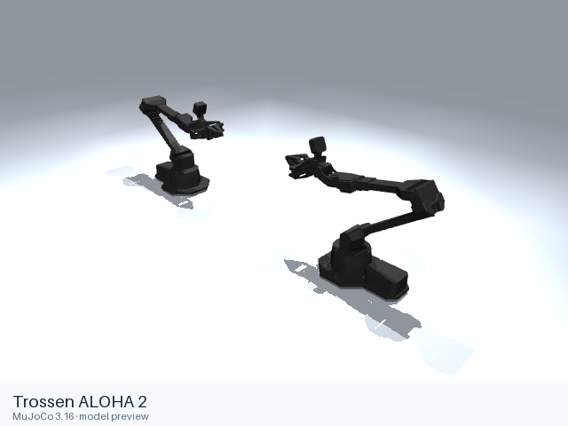

# Trossen ALOHA 2

[Manufacturer gallery](../README.md) · [All manufacturers](../../../README.md)



MuJoCo preview · [Rendering record](preview.json) · [Rendering method](../../../docs/PREVIEWS.md)

Bimanual ALOHA 2 follower arms with its linear-actuated parallel grippers. The complete scene includes the worktable, extrusion frame and four calibrated cameras.

## Model entries

Entry paths are relative to the repository root.

| Purpose / assembly | Format | Entry path | Target environment and required loading options |
|---|---|---|---|
| Robot with grippers | MJCF | [`models/trossen/aloha2/mjcf/aloha.xml`](mjcf/aloha.xml) | MuJoCo native XML loader; use an absolute entry path. |
| Complete worktable and camera assembly | MJCF | [`models/trossen/aloha2/mjcf/scene.xml`](mjcf/scene.xml) | MuJoCo native XML loader; use an absolute entry path. |

## Mechanical information

| Item | Definition |
|---|---|
| Hardware revision and gripper | ALOHA 2; two ViperX 300 6DOF-derived follower arms and ALOHA 2 grippers |
| Units | Metres, kilograms, radians; native mesh scales are retained. |
| Base | Fixed `left/base_link` and `right/base_link`; the scene adds the worktable and camera frame. |
| Arm joint order | Per side (`left/`, `right/`): `waist`, `shoulder`, `elbow`, `forearm_roll`, `wrist_angle`, `wrist_rotate`. |
| Gripper | Each side has `left_finger` and `right_finger` slide joints linked by an equality constraint; the source linear actuator and transmission are retained. |
| End effector / TCP | `left/gripper` and `right/gripper` sites; finger contact sites are also included. |
| Included poses | `neutral_pose` keyframe. |

## Loading example

```python
import mujoco

model = mujoco.MjModel.from_xml_path(
    '/absolute/path/to/awesome-robot-arm-zoo/models/trossen/aloha2/mjcf/aloha.xml'
)
data = mujoco.MjData(model)
mujoco.mj_forward(model, data)
```

## Sources and licensing

| Format or file scope | Upstream project | Version | Upstream file path | License file |
|---|---|---|---|---|
| MJCF and referenced resources | [Upstream project](https://github.com/google-deepmind/mujoco_menagerie) | `6da8b971844845de6ab27315aacc3a3fea4ddb8e` | `aloha` | [BSD-3-Clause](mjcf/LICENSE) |

Upstream copyright notices and redistribution terms are retained alongside each format.

## Model preparation

Native Menagerie XML, meshes and textures retain their upstream contents. The robot entry includes the default joint-position actuators and control keyframe. The separate scene includes the worktable, extrusion frame, overhead and worms-eye cameras; wrist cameras are part of the robot.

## Loading verification

Checks performed on 2026-10-16. The complete format directory was copied to a temporary location and loaded by absolute path from a separate working directory.

| Entry | Environment and simulator version | Verification steps | Result |
|---|---|---|---|
| `models/trossen/aloha2/mjcf/aloha.xml` | macOS 27.2, arm64, Python 3.12.14; MuJoCo 3.16.0 | Copy the complete format directory, change caller directory, compile XML and call `mj_forward`. | Passed, including resource relocation. |
| `models/trossen/aloha2/mjcf/scene.xml` | macOS 27.2, arm64, Python 3.12.14; MuJoCo 3.16.0 | Copy the complete format directory, change caller directory, compile XML and call `mj_forward`. | Passed, including resource relocation. |

## Known limitations

The native model is a simplified ALOHA 2 simulation description. Its identified actuator and friction parameters belong to this model; physical-controller behavior has not been validated here. MuJoCo versions earlier than the upstream minimum of 3.1.1 have not been tested.

Dynamic task execution, policy performance and training behavior have not been validated.
