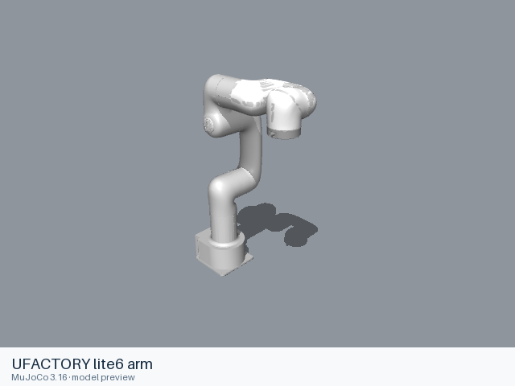
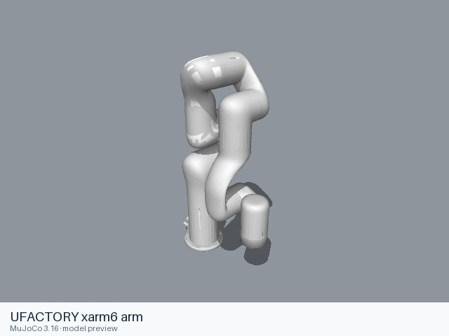

# Ufactory models

[All manufacturers](../../README.md#models) · [Chinese index](../../README_CN.md#模型目录)

Previews are rendered with MuJoCo. See the [rendering method](../../docs/PREVIEWS.md); each model page links its exact entry and rendering record.

The URDF entries listed below come from manufacturer-maintained public repositories. Source versions and file scopes are recorded with each model.

| Preview | Model / assembly | Native entries | URDF source status | URDF source |
|---|---|---|---|---|
|  | [UFACTORY dual xArm7](dual_xarm7/README.md) | [URDF](dual_xarm7/urdf/dual_xarm7.urdf) | Official manufacturer repository | [xarm_ros2](https://github.com/xArm-Developer/xarm_ros2) |
|  | [UFACTORY lite6 arm](lite6/README.md) | [URDF](lite6/urdf/arm/lite6.urdf) [MJCF](lite6/mjcf/menagerie/lite6.xml) [All 6 entries](lite6/README.md#model-entries) | Official manufacturer repository | [xarm_ros2](https://github.com/xArm-Developer/xarm_ros2) |
|  | [UFACTORY xarm6 arm](xarm6/README.md) | [URDF](xarm6/urdf/arm/xarm6.urdf) [All 2 entries](xarm6/README.md#model-entries) | Official manufacturer repository | [xarm_ros2](https://github.com/xArm-Developer/xarm_ros2) |
|  | [UFACTORY xarm7 arm](xarm7/README.md) | [URDF](xarm7/urdf/arm/xarm7.urdf) [MJCF](xarm7/mjcf/menagerie/xarm7.xml) [All 5 entries](xarm7/README.md#model-entries) | Official manufacturer repository | [xarm_ros2](https://github.com/xArm-Developer/xarm_ros2) |

## Curated MuJoCo entries

The following MJCF files come from the Google DeepMind-maintained MuJoCo Menagerie collection. Their model-specific licenses and source versions are recorded with each entry.

| Model | Format notes | Model documentation |
|---|---|---|
| UFACTORY xArm7 | [MJCF](xarm7/mjcf/README.md) | [Model notes](xarm7/README.md) |
| UFACTORY Lite6 | [MJCF](lite6/mjcf/README.md) | [Model notes](lite6/README.md) |
