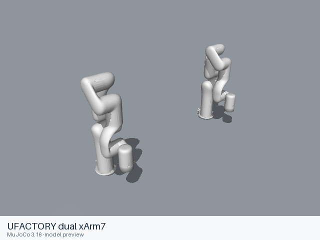

# UFACTORY dual xArm7

[Manufacturer gallery](../README.md) · [All manufacturers](../../../README.md)



MuJoCo preview · [Rendering record](preview.json) · [Rendering method](../../../docs/PREVIEWS.md)

Official manufacturer model files for the assembly identified below.

## Model entries

Entry paths are relative to the repository root.

| Purpose / assembly | Format | Entry path | Target environment and required loading options |
|---|---|---|---|
| Complete assembly | URDF | [`models/ufactory/dual_xarm7/urdf/dual_xarm7.urdf`](urdf/dual_xarm7.urdf) | Local file loader; use a fixed base for mounted arms. |

## Mechanical information

### UFACTORY dual xArm7

| Item | Definition |
|---|---|
| Hardware revision and gripper | UFACTORY dual xArm7; configuration represented by the entry. |
| Units | URDF SI conventions: metres, kilograms, radians. Mesh scaling is retained from upstream. |
| Base | `world`; attach this root frame to the consuming scene. |
| Movable joint order | `L_joint1`, `L_joint2`, `L_joint3`, `L_joint4`, `L_joint5`, `L_joint6`, `L_joint7`, `R_joint1`, `R_joint2`, `R_joint3`, `R_joint4`, `R_joint5`, `R_joint6`, `R_joint7` (upstream declaration order; fixed joints omitted). |
| Gripper | No mimic coupling is declared. Any gripper joint limits remain in the entry. |
| End effector / TCP | Leaf frames: `L_link_eef`, `R_link_eef`. Their upstream transforms are retained. |
| Included poses | No separate pose configuration is included. |

### URDF joint limits

| Joint | Type | Lower | Upper | Units |
|---|---|---|---|---|
| `L_joint1` | revolute | -6.283185307179586 | 6.283185307179586 | radians |
| `L_joint2` | revolute | -2.059 | 2.0944 | radians |
| `L_joint3` | revolute | -6.283185307179586 | 6.283185307179586 | radians |
| `L_joint4` | revolute | -0.19198 | 3.927 | radians |
| `L_joint5` | revolute | -6.283185307179586 | 6.283185307179586 | radians |
| `L_joint6` | revolute | -1.69297 | 3.141592653589793 | radians |
| `L_joint7` | revolute | -6.283185307179586 | 6.283185307179586 | radians |
| `R_joint1` | revolute | -6.283185307179586 | 6.283185307179586 | radians |
| `R_joint2` | revolute | -2.059 | 2.0944 | radians |
| `R_joint3` | revolute | -6.283185307179586 | 6.283185307179586 | radians |
| `R_joint4` | revolute | -0.19198 | 3.927 | radians |
| `R_joint5` | revolute | -6.283185307179586 | 6.283185307179586 | radians |
| `R_joint6` | revolute | -1.69297 | 3.141592653589793 | radians |
| `R_joint7` | revolute | -6.283185307179586 | 6.283185307179586 | radians |

## Loading example

```python
from yourdfpy import URDF

robot = URDF.load(
    '/absolute/path/to/awesome-robot-arm-zoo/models/ufactory/dual_xarm7/urdf/dual_xarm7.urdf',
    load_meshes=True, load_collision_meshes=True,
    build_collision_scene_graph=True,
)
```

## Sources and licensing

| Format or file scope | Upstream project | Version | Upstream file path | License file |
|---|---|---|---|---|
| URDF entry and referenced resources | [xarm_ros2](https://github.com/xArm-Developer/xarm_ros2) | `62936f7ea1846a85f7350de2c4c18f39e6d19715` | `xarm_description/urdf/dual_xarm_device.urdf.xacro` | [LICENSE](urdf/LICENSE), [NOTICES](urdf/NOTICES) |

License: BSD-3-Clause. The license and attribution notices apply to the model entry and copied dependencies from the stated project.

## Model preparation

The official default pair has left and right bases separated by 1 metre along Y. Xacro 2.1.1 expansion mappings: `{"add_bio_gripper_1": "false", "add_bio_gripper_2": "false", "add_d435i_links_1": "true", "add_d435i_links_2": "true", "add_gripper_1": "false", "add_gripper_2": "false", "add_other_geometry_1": "false", "add_other_geometry_2": "false", "add_realsense_d435i_1": "false", "add_realsense_d435i_2": "false", "add_vacuum_gripper_1": "false", "add_vacuum_gripper_2": "false", "attach_rpy_1": "0 0 0", "attach_rpy_2": "0 0 0", "attach_xyz_1": "0 0 0", "attach_xyz_2": "0 1 0", "baud_checkset_1": "true", "baud_checkset_2": "true", "default_gripper_baud_1": "2000000", "default_gripper_baud_2": "2000000", "dof_1": "7", "dof_2": "7", "effort_control": "false", "geometry_height_1": "0.1", "geometry_height_2": "0.1", "geometry_length_1": "0.1", "geometry_length_2": "0.1", "geometry_mass_1": "0.1", "geometry_mass_2": "0.1", "geometry_mesh_filename_1": "", "geometry_mesh_filename_2": "", "geometry_mesh_origin_rpy_1": "0 0 0", "geometry_mesh_origin_rpy_2": "0 0 0", "geometry_mesh_origin_xyz_1": "0 0 0", "geometry_mesh_origin_xyz_2": "0 0 0", "geometry_mesh_tcp_rpy_1": "0 0 0", "geometry_mesh_tcp_rpy_2": "0 0 0", "geometry_mesh_tcp_xyz_1": "0 0 0", "geometry_mesh_tcp_xyz_2": "0 0 0", "geometry_radius_1": "0.1", "geometry_radius_2": "0.1", "geometry_type_1": "box", "geometry_type_2": "box", "geometry_width_1": "0.1", "geometry_width_2": "0.1", "gripper_version_1": "G1", "gripper_version_2": "G1", "hw_ns": "xarm", "kinematics_suffix_1": "", "kinematics_suffix_2": "", "limited": "false", "mesh_suffix": "stl", "model1300_1": "false", "model1300_2": "false", "prefix_1": "L_", "prefix_2": "R_", "report_type_1": "normal", "report_type_2": "normal", "robot_ip_1": "", "robot_ip_2": "", "robot_sn_1": "", "robot_sn_2": "", "robot_type_1": "xarm", "robot_type_2": "xarm", "ros2_control_params": "", "ros2_control_plugin": "uf_robot_hardware/UFRobotSystemHardware", "velocity_control": "false"}`. Referenced resources are stored inside the format directory and resource URIs are relative to the entry. Joint limits, inertial values, visual and collision geometry retain their upstream definitions.

## Loading verification

Checks performed on 2026-10-15. The complete format directory was copied to a temporary location and loaded by absolute path from a separate working directory.

| Entry | Environment and loader version | Verification steps | Result |
|---|---|---|---|
| `models/ufactory/dual_xarm7/urdf/dual_xarm7.urdf` | macOS 27.2, arm64, Python 3.12.14; yourdfpy 0.0.60 | Load visual/collision geometry and update the joint configuration. | Passed, including resource relocation. |

## Known limitations

Dynamic task execution, controller performance and training behavior have not been validated.

- ROS and Gazebo control extensions, when present, retain their upstream metadata; their external runtime plugins are not included.
- Upstream hardware or revision distinctions beyond the source filename are not independently established.
- The URDF has no inertial element for `world`, `L_link_eef`, `R_link_eef`.
