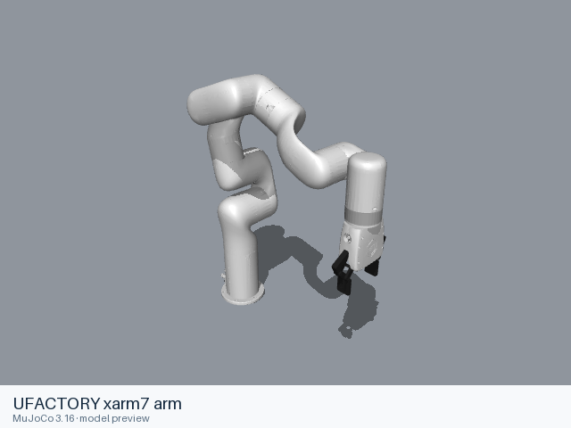

# UFACTORY xarm7 arm

[Manufacturer gallery](../README.md) · [All manufacturers](../../../README.md)



MuJoCo preview · [Rendering record](preview.json) · [Rendering method](../../../docs/PREVIEWS.md)

Official manufacturer model files for the assembly identified below.

## Model entries

Entry paths are relative to the repository root.

| Purpose / assembly | Format | Entry path | Target environment and required loading options |
|---|---|---|---|
| Robot model — arm | URDF | [`models/ufactory/xarm7/urdf/arm/xarm7.urdf`](urdf/arm/xarm7.urdf) | Local file loader; use a fixed base for mounted arms. |
| Robot model — with_gripper | URDF | [`models/ufactory/xarm7/urdf/with_gripper/xarm7.urdf`](urdf/with_gripper/xarm7.urdf) | Local file loader; use a fixed base for mounted arms. |
| Robot model — Upstream robot assembly | MJCF | [`models/ufactory/xarm7/mjcf/menagerie/xarm7.xml`](mjcf/menagerie/xarm7.xml) | MuJoCo; complete relative resources are included. |
| Robot model — Arm without hand | MJCF | [`models/ufactory/xarm7/mjcf/menagerie/xarm7_nohand.xml`](mjcf/menagerie/xarm7_nohand.xml) | MuJoCo; complete relative resources are included. |
| Demonstration scene — Robot with floor, skybox and lighting | MJCF | [`models/ufactory/xarm7/mjcf/menagerie/scene.xml`](mjcf/menagerie/scene.xml) | MuJoCo; complete relative resources are included. |

## Mechanical information

The URDF information below describes its manufacturer or maintainer assembly. For the separate curated MJCF assembly, joint names and actuators, see [MJCF model notes](mjcf/README.md).

### arm

| Item | Definition |
|---|---|
| Hardware revision and gripper | UFACTORY xarm7 arm; configuration represented by the entry. |
| Units | URDF SI conventions: metres, kilograms, radians. Mesh scaling is retained from upstream. |
| Base | `world`; attach this root frame to the consuming scene. |
| Movable joint order | `joint1`, `joint2`, `joint3`, `joint4`, `joint5`, `joint6`, `joint7` (upstream declaration order; fixed joints omitted). |
| Gripper | No mimic coupling is declared. Any gripper joint limits remain in the entry. |
| End effector / TCP | Leaf frames: `link_eef`. Their upstream transforms are retained. |
| Included poses | No separate pose configuration is included. |
### with_gripper

| Item | Definition |
|---|---|
| Hardware revision and gripper | UFACTORY xarm7 with gripper; configuration represented by the entry. |
| Units | URDF SI conventions: metres, kilograms, radians. Mesh scaling is retained from upstream. |
| Base | `world`; attach this root frame to the consuming scene. |
| Movable joint order | `joint1`, `joint2`, `joint3`, `joint4`, `joint5`, `joint6`, `joint7`, `drive_joint`, `left_finger_joint`, `left_inner_knuckle_joint`, `right_outer_knuckle_joint`, `right_finger_joint`, `right_inner_knuckle_joint` (upstream declaration order; fixed joints omitted). |
| Gripper | left_finger_joint mimics drive_joint (multiplier 1, offset 0); left_inner_knuckle_joint mimics drive_joint (multiplier 1, offset 0); right_outer_knuckle_joint mimics drive_joint (multiplier 1, offset 0); right_finger_joint mimics drive_joint (multiplier 1, offset 0); right_inner_knuckle_joint mimics drive_joint (multiplier 1, offset 0) |
| End effector / TCP | Leaf frames: `left_finger`, `left_inner_knuckle`, `right_finger`, `right_inner_knuckle`, `link_tcp`. Their upstream transforms are retained. |
| Included poses | No separate pose configuration is included. |

### URDF / arm joint limits

| Joint | Type | Lower | Upper | Units |
|---|---|---|---|---|
| `joint1` | revolute | -6.283185307179586 | 6.283185307179586 | radians |
| `joint2` | revolute | -2.059 | 2.0944 | radians |
| `joint3` | revolute | -6.283185307179586 | 6.283185307179586 | radians |
| `joint4` | revolute | -0.19198 | 3.927 | radians |
| `joint5` | revolute | -6.283185307179586 | 6.283185307179586 | radians |
| `joint6` | revolute | -1.69297 | 3.141592653589793 | radians |
| `joint7` | revolute | -6.283185307179586 | 6.283185307179586 | radians |

### URDF / with_gripper joint limits

| Joint | Type | Lower | Upper | Units |
|---|---|---|---|---|
| `joint1` | revolute | -6.283185307179586 | 6.283185307179586 | radians |
| `joint2` | revolute | -2.059 | 2.0944 | radians |
| `joint3` | revolute | -6.283185307179586 | 6.283185307179586 | radians |
| `joint4` | revolute | -0.19198 | 3.927 | radians |
| `joint5` | revolute | -6.283185307179586 | 6.283185307179586 | radians |
| `joint6` | revolute | -1.69297 | 3.141592653589793 | radians |
| `joint7` | revolute | -6.283185307179586 | 6.283185307179586 | radians |
| `drive_joint` | revolute | 0 | 0.85 | radians |
| `left_finger_joint` | revolute | 0 | 0.85 | radians |
| `left_inner_knuckle_joint` | revolute | 0 | 0.85 | radians |
| `right_outer_knuckle_joint` | revolute | 0 | 0.85 | radians |
| `right_finger_joint` | revolute | 0 | 0.85 | radians |
| `right_inner_knuckle_joint` | revolute | 0 | 0.85 | radians |

## Loading example

```python
from yourdfpy import URDF

robot = URDF.load(
    '/absolute/path/to/awesome-robot-arm-zoo/models/ufactory/xarm7/urdf/arm/xarm7.urdf',
    load_meshes=True, load_collision_meshes=True,
    build_collision_scene_graph=True,
)
```

```python
import mujoco

model = mujoco.MjModel.from_xml_path(
    '/absolute/path/to/awesome-robot-arm-zoo/models/ufactory/xarm7/mjcf/menagerie/xarm7.xml'
)
data = mujoco.MjData(model)
mujoco.mj_forward(model, data)
```

## Sources and licensing

| Format or file scope | Upstream project | Version | Upstream file path | License file |
|---|---|---|---|---|
| URDF / arm entry and referenced resources | [xarm_ros2](https://github.com/xArm-Developer/xarm_ros2) | `62936f7ea1846a85f7350de2c4c18f39e6d19715` | `xarm_description/urdf/xarm_device.urdf.xacro` | [LICENSE](urdf/arm/LICENSE), [NOTICES](urdf/arm/NOTICES) |
| URDF / with_gripper entry and referenced resources | [xarm_ros2](https://github.com/xArm-Developer/xarm_ros2) | `62936f7ea1846a85f7350de2c4c18f39e6d19715` | `xarm_description/urdf/xarm_device.urdf.xacro` | [LICENSE](urdf/with_gripper/LICENSE), [NOTICES](urdf/with_gripper/NOTICES) |
| Curated MJCF and referenced assets | [Google DeepMind MuJoCo Menagerie](https://github.com/google-deepmind/mujoco_menagerie) | `6da8b971844845de6ab27315aacc3a3fea4ddb8e` | `ufactory_xarm7/` | [Model license](mjcf/menagerie/LICENSE), [notices](mjcf/menagerie/NOTICES) |

License: BSD-3-Clause. The license and attribution notices apply to the model entry and copied dependencies from the stated project.

## Model preparation

The MJCF entries and dependencies retain the curator’s model definitions and relative paths. [MJCF model notes](mjcf/README.md) describe that format separately.

 Xacro 2.1.1 expansion mappings: `{"add_bio_gripper": "false", "add_d435i_links": "true", "add_gripper": "false", "add_other_geometry": "false", "add_realsense_d435i": "false", "add_vacuum_gripper": "false", "attach_rpy": "0 0 0", "attach_to": "world", "attach_xyz": "0 0 0", "baud_checkset": "true", "default_gripper_baud": "2000000", "dof": "7", "effort_control": "false", "geometry_height": "0.1", "geometry_length": "0.1", "geometry_mass": "0.1", "geometry_mesh_filename": "", "geometry_mesh_origin_rpy": "0 0 0", "geometry_mesh_origin_xyz": "0 0 0", "geometry_mesh_tcp_rpy": "0 0 0", "geometry_mesh_tcp_xyz": "0 0 0", "geometry_radius": "0.1", "geometry_type": "box", "geometry_width": "0.1", "gripper_version": "G1", "hw_ns": "xarm", "kinematics_suffix": "", "limited": "false", "mesh_suffix": "stl", "model1300": "false", "prefix": "", "report_type": "normal", "robot_ip": "", "robot_sn": "", "robot_type": "xarm", "ros2_control_params": "", "ros2_control_plugin": "uf_robot_hardware/UFRobotSystemHardware", "use_gazebo_camera": "false", "velocity_control": "false"}`. Referenced resources are stored inside the format directory and resource URIs are relative to the entry. Joint limits, inertial values, visual and collision geometry retain their upstream definitions.

 Xacro 2.1.1 expansion mappings: `{"add_bio_gripper": "false", "add_d435i_links": "true", "add_gripper": "true", "add_other_geometry": "false", "add_realsense_d435i": "false", "add_vacuum_gripper": "false", "attach_rpy": "0 0 0", "attach_to": "world", "attach_xyz": "0 0 0", "baud_checkset": "true", "default_gripper_baud": "2000000", "dof": "7", "effort_control": "false", "geometry_height": "0.1", "geometry_length": "0.1", "geometry_mass": "0.1", "geometry_mesh_filename": "", "geometry_mesh_origin_rpy": "0 0 0", "geometry_mesh_origin_xyz": "0 0 0", "geometry_mesh_tcp_rpy": "0 0 0", "geometry_mesh_tcp_xyz": "0 0 0", "geometry_radius": "0.1", "geometry_type": "box", "geometry_width": "0.1", "gripper_version": "G1", "hw_ns": "xarm", "kinematics_suffix": "", "limited": "false", "mesh_suffix": "stl", "model1300": "false", "prefix": "", "report_type": "normal", "robot_ip": "", "robot_sn": "", "robot_type": "xarm", "ros2_control_params": "", "ros2_control_plugin": "uf_robot_hardware/UFRobotSystemHardware", "use_gazebo_camera": "false", "velocity_control": "false"}`. Referenced resources are stored inside the format directory and resource URIs are relative to the entry. Joint limits, inertial values, visual and collision geometry retain their upstream definitions.

## Loading verification

Checks performed on 2026-10-15. The complete format directory was copied to a temporary location and loaded by absolute path from a separate working directory.

| Entry | Environment and loader version | Verification steps | Result |
|---|---|---|---|
| `models/ufactory/xarm7/urdf/arm/xarm7.urdf` | macOS 27.2, arm64, Python 3.12.14; yourdfpy 0.0.60 | Load visual/collision geometry and update the joint configuration. | Passed, including resource relocation. |
| `models/ufactory/xarm7/urdf/with_gripper/xarm7.urdf` | macOS 27.2, arm64, Python 3.12.14; yourdfpy 0.0.60 | Load visual/collision geometry and update the joint configuration. | Passed, including resource relocation. |
| `models/ufactory/xarm7/mjcf/menagerie/xarm7.xml` | macOS 27.2, arm64, Python 3.12.14; MuJoCo 3.16.0 | Compile the model, construct MjData and run mj_forward. | Passed, including resource relocation. |
| `models/ufactory/xarm7/mjcf/menagerie/xarm7_nohand.xml` | macOS 27.2, arm64, Python 3.12.14; MuJoCo 3.16.0 | Compile the model, construct MjData and run mj_forward. | Passed, including resource relocation. |
| `models/ufactory/xarm7/mjcf/menagerie/scene.xml` | macOS 27.2, arm64, Python 3.12.14; MuJoCo 3.16.0 | Compile the model, construct MjData and run mj_forward. | Passed, including resource relocation. |

## Known limitations

Dynamic task execution, controller performance and training behavior have not been validated.

- ROS and Gazebo control extensions, when present, retain their upstream metadata; their external runtime plugins are not included.
- Upstream hardware or revision distinctions beyond the source filename are not independently established.
- The URDF has no inertial element for `world`, `link_eef`.
- The URDF has no inertial element for `world`, `link_eef`, `link_tcp`.
