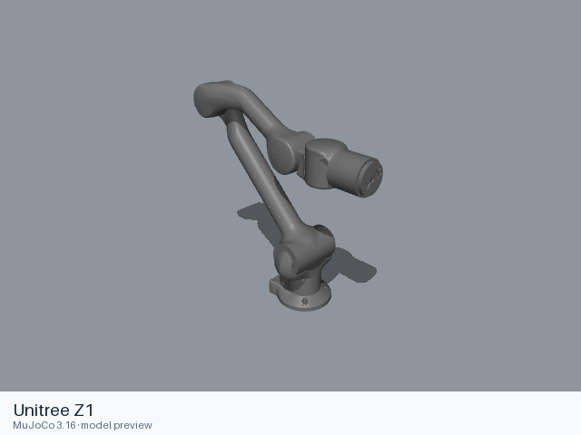

# Unitree

[All manufacturers](../../README.md#models) · [Chinese index](../../README_CN.md#模型目录)

Previews are rendered with MuJoCo. See the [rendering method](../../docs/PREVIEWS.md); each model page links its exact entry and rendering record.

Models and resources are extracted from the linked official manufacturer repositories. Each format directory retains its applicable upstream license.

| Preview | Model / assembly | Native entries |
|---|---|---|
|  | [Unitree Z1](z1/README.md) | [URDF](z1/urdf/z1.urdf) [MJCF](z1/mjcf/menagerie/z1.xml) [All 4 entries](z1/README.md#model-entries) |

## Sources and licensing

- [Official upstream](https://github.com/unitreerobotics/unitree_ros). Exact revisions and file scopes are recorded in each model README.

## Curated MuJoCo entries

The following MJCF files come from the Google DeepMind-maintained MuJoCo Menagerie collection. Their model-specific licenses and source versions are recorded with each entry.

| Model | Format notes | Model documentation |
|---|---|---|
| Unitree Z1 | [MJCF](z1/mjcf/README.md) | [Model notes](z1/README.md) |
