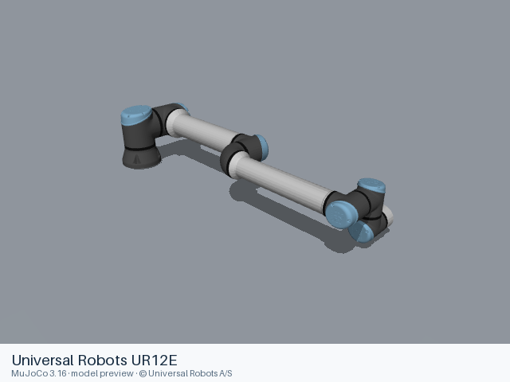
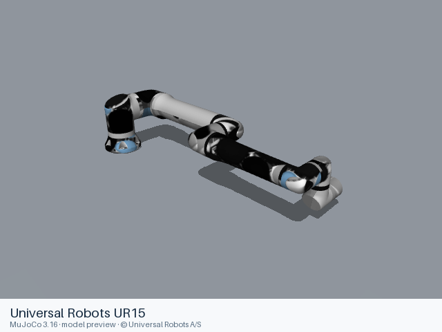
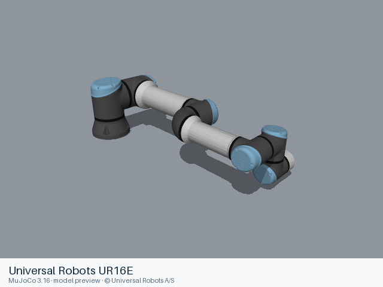
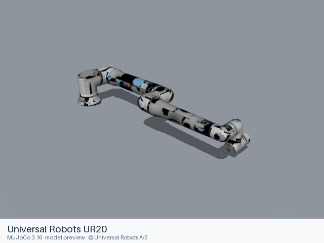
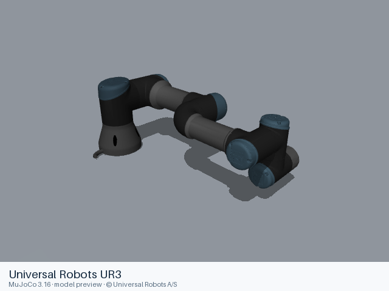
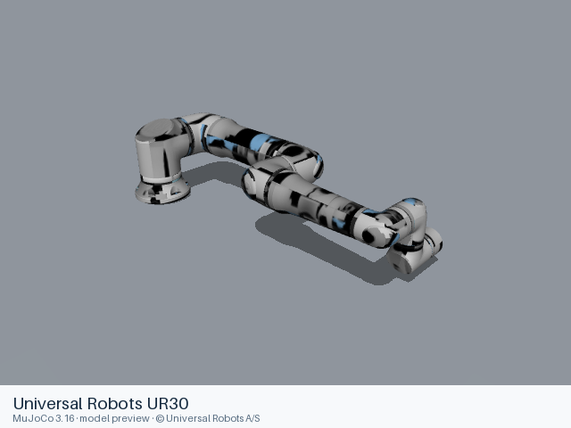
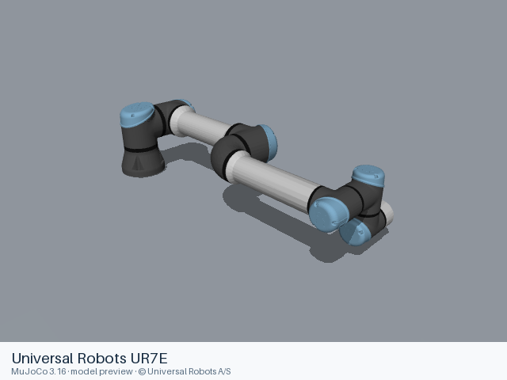
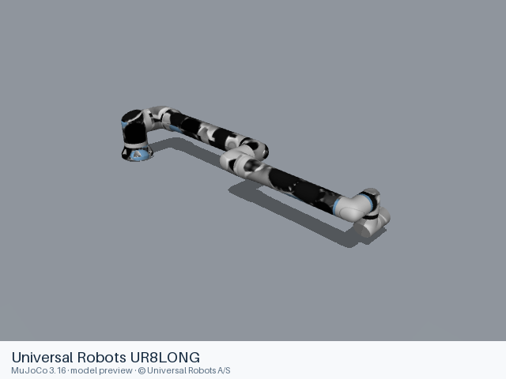

# Universal Robots models

[All manufacturers](../../README.md#models) · [Chinese index](../../README_CN.md#模型目录)

Previews are rendered with MuJoCo. See the [rendering method](../../docs/PREVIEWS.md); each model page links its exact entry and rendering record.

Official Universal Robots descriptions from the manufacturer’s ROS 2 description repository. The CB3, e-Series and newer arm families use manufacturer default parameters. UR8LONG, UR15, UR18, UR20 and UR30 mesh families carry Universal Robots Graphical Documentation terms; other content is BSD-3-Clause. The applicable terms accompany each affected model.

| Preview | Model / assembly | Native entries | URDF upstream |
|---|---|---|---|
|  | [Universal Robots UR10](ur10/README.md) | [URDF](ur10/urdf/ur10.urdf) | [Universal_Robots_ROS2_Description](https://github.com/UniversalRobots/Universal_Robots_ROS2_Description) |
|  | [Universal Robots UR10E](ur10e/README.md) | [URDF](ur10e/urdf/ur10e.urdf) [MJCF](ur10e/mjcf/menagerie/ur10e.xml) [All 3 entries](ur10e/README.md#model-entries) | [Universal_Robots_ROS2_Description](https://github.com/UniversalRobots/Universal_Robots_ROS2_Description) |
|  | [Universal Robots UR12E](ur12e/README.md) | [URDF](ur12e/urdf/ur12e.urdf) | [Universal_Robots_ROS2_Description](https://github.com/UniversalRobots/Universal_Robots_ROS2_Description) |
|  | [Universal Robots UR15](ur15/README.md) | [URDF](ur15/urdf/ur15.urdf) | [Universal_Robots_ROS2_Description](https://github.com/UniversalRobots/Universal_Robots_ROS2_Description) |
|  | [Universal Robots UR16E](ur16e/README.md) | [URDF](ur16e/urdf/ur16e.urdf) | [Universal_Robots_ROS2_Description](https://github.com/UniversalRobots/Universal_Robots_ROS2_Description) |
|  | [Universal Robots UR18](ur18/README.md) | [URDF](ur18/urdf/ur18.urdf) | [Universal_Robots_ROS2_Description](https://github.com/UniversalRobots/Universal_Robots_ROS2_Description) |
|  | [Universal Robots UR20](ur20/README.md) | [URDF](ur20/urdf/ur20.urdf) | [Universal_Robots_ROS2_Description](https://github.com/UniversalRobots/Universal_Robots_ROS2_Description) |
|  | [Universal Robots UR3](ur3/README.md) | [URDF](ur3/urdf/ur3.urdf) | [Universal_Robots_ROS2_Description](https://github.com/UniversalRobots/Universal_Robots_ROS2_Description) |
|  | [Universal Robots UR30](ur30/README.md) | [URDF](ur30/urdf/ur30.urdf) | [Universal_Robots_ROS2_Description](https://github.com/UniversalRobots/Universal_Robots_ROS2_Description) |
|  | [Universal Robots UR3E](ur3e/README.md) | [URDF](ur3e/urdf/ur3e.urdf) | [Universal_Robots_ROS2_Description](https://github.com/UniversalRobots/Universal_Robots_ROS2_Description) |
|  | [Universal Robots UR5](ur5/README.md) | [URDF](ur5/urdf/ur5.urdf) | [Universal_Robots_ROS2_Description](https://github.com/UniversalRobots/Universal_Robots_ROS2_Description) |
|  | [Universal Robots UR5E](ur5e/README.md) | [URDF](ur5e/urdf/ur5e.urdf) [MJCF](ur5e/mjcf/menagerie/ur5e.xml) [All 3 entries](ur5e/README.md#model-entries) | [Universal_Robots_ROS2_Description](https://github.com/UniversalRobots/Universal_Robots_ROS2_Description) |
|  | [Universal Robots UR7E](ur7e/README.md) | [URDF](ur7e/urdf/ur7e.urdf) | [Universal_Robots_ROS2_Description](https://github.com/UniversalRobots/Universal_Robots_ROS2_Description) |
|  | [Universal Robots UR8LONG](ur8long/README.md) | [URDF](ur8long/urdf/ur8long.urdf) | [Universal_Robots_ROS2_Description](https://github.com/UniversalRobots/Universal_Robots_ROS2_Description) |

Each model contains a static entry, the resources it references, and its applicable license files. Mechanical details and loading records are in the model READMEs.

## Curated MuJoCo entries

The following MJCF files come from the Google DeepMind-maintained MuJoCo Menagerie collection. Their model-specific licenses and source versions are recorded with each entry.

| Model | Format notes | Model documentation |
|---|---|---|
| Universal Robots UR5e | [MJCF](ur5e/mjcf/README.md) | [Model notes](ur5e/README.md) |
| Universal Robots UR10e | [MJCF](ur10e/mjcf/README.md) | [Model notes](ur10e/README.md) |
