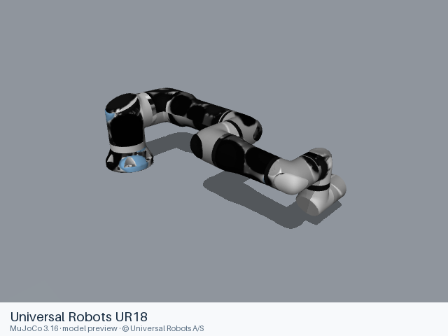

# Universal Robots UR18

[Manufacturer gallery](../README.md) · [All manufacturers](../../../README.md)



MuJoCo preview · [Rendering record](preview.json) · [Rendering method](../../../docs/PREVIEWS.md)

UR18 6-joint arm without an end effector. The entry preserves the upstream kinematic, visual, collision, inertial and joint-limit definitions.

## Model entries

Entry paths are relative to the repository root.

| Purpose / assembly | Format | Entry path | Target environment and required loading options |
|---|---|---|---|
| Robot model: UR18 6-joint arm without an end effector | URDF | [`models/universal_robots/ur18/urdf/ur18.urdf`](urdf/ur18.urdf) | A native URDF loader with relative mesh resolution; attach the base to the consuming scene. |

## Mechanical information

| Item | Definition |
|---|---|
| Hardware revision and gripper | UR18 6-joint arm without an end effector |
| Units | Metres, kilograms, radians; revolute joint effort in N·m and prismatic effort in N. Mesh scale attributes remain as supplied upstream. |
| Base | `world`; root of the URDF tree. Any supplied fixed base transform is retained. |
| Arm joint order | `shoulder_pan_joint` → `shoulder_lift_joint` → `elbow_joint` → `wrist_1_joint` → `wrist_2_joint` → `wrist_3_joint` |
| Gripper | No gripper is included. |
| End effector / TCP | `flange`, `tool0`; fixed transforms remain in the entry. |
| Included poses | No named poses are defined by this URDF entry. |

## Loading example

```python
from yourdfpy import URDF

robot = URDF.load(
    '/absolute/path/to/awesome-robot-arm-zoo/models/universal_robots/ur18/urdf/ur18.urdf',
    load_meshes=True, load_collision_meshes=True,
    build_collision_scene_graph=True,
)
```

## Sources and licensing

| Format or file scope | Upstream project | Version | Upstream file path | License file |
|---|---|---|---|---|
| Static URDF and its bundled resources (ur_description) | [https://github.com/UniversalRobots/Universal_Robots_ROS2_Description](https://github.com/UniversalRobots/Universal_Robots_ROS2_Description) | `d4042c1f5123c86645cc5dbd650b4f461f697ee9` | `urdf/ur.urdf.xacro`; model mesh paths under the named packages | [LICENSE](urdf/LICENSE), [LICENSE.ur15](urdf/LICENSE.ur15), [LICENSE.ur18](urdf/LICENSE.ur18) |

Bundled upstream resource directories: `meshes/ur15/collision`, `meshes/ur15/visual`, `meshes/ur18/collision`, `meshes/ur18/visual`.

License scope: BSD-3-Clause for the URDF and ordinary mesh families; `ur15`, `ur18` meshes and textures use Universal Robots Terms and Conditions for Use of Graphical Documentation (version 1.01 / 2023-09-12). The complete upstream license texts and notices accompany this format directory.

© 2023 Universal Robots A/S. Use hereof is subject to Universal Robots A/S’ Terms and Conditions for Use of Graphical Documentation.

## Model preparation

The static entry was expanded with xacro 2.1.1 using ur_type:=ur18, name:=ur18. Resources were copied only when referenced by the entry or by one of its mesh/material files. Resource references are local relative paths. Mesh contents and physical parameters retain the upstream definitions. The manufacturer default per-model joint-limit, kinematic, physical and visual YAML files select the mechanical definitions. The upstream world-to-base fixed attachment is retained.

## Loading verification

Checks performed on 2026-10-15. The complete format directory was copied to a temporary location and loaded by absolute path from a separate working directory.

| Entry | Environment and loader version | Verification steps | Result |
|---|---|---|---|
| `models/universal_robots/ur18/urdf/ur18.urdf` | macOS 27.2, arm64, Python 3.12.14; yourdfpy 0.0.60 | Load visual/collision geometry and update the joint configuration. | Passed, including resource relocation. |

## Known limitations

Dynamic task execution, controller performance and training behavior have not been validated.

ROS, Gazebo and physics simulators have not been verified for this entry. The default nominal kinematic parameters are supplied, rather than serial-number-specific robot calibration. These mesh families use non-OSI terms that restrict permitted uses, competing products and redistribution. Public redistribution must be inside a software package containing the terms; see the included mesh-family licenses.
