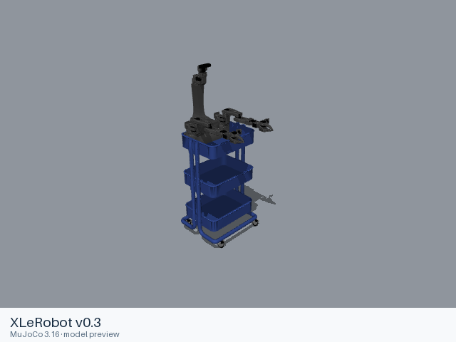

# XLeRobot v0.3

[Manufacturer gallery](../README.md) · [All manufacturers](../../../README.md)



MuJoCo preview · [Rendering record](preview.json) · [Rendering method](../../../docs/PREVIEWS.md)

XLeRobot v0.3-era RÅSKOG cart assembly from the upstream ManiSkill model: two six-joint SO-100-style arms with rotary grippers, arm cameras, and a pan/tilt camera head.

## Model entries

Entry paths are relative to the repository root.

| Purpose / assembly | Format | Entry path | Target environment and required loading options |
|---|---|---|---|
| Complete mobile manipulator | URDF | [`models/xlerobot/xlerobot_v0_3/urdf/xlerobot.urdf`](urdf/xlerobot.urdf) | Native URDF loader; load visual and collision resources. Root motion as documented below. |

## Mechanical information

| Item | Definition |
|---|---|
| Hardware revision and gripper | RÅSKOG cart, dual follower arms and native rotary jaw grippers |
| Units | Metres, kilograms and radians; native mesh scales are retained. |
| Base | `root`, with `root_x_axis_joint`, `root_y_axis_joint` and `root_z_rotation_joint` providing planar chassis motion. |
| Movable joint order | `root_x_axis_joint`, `root_y_axis_joint`, `root_z_rotation_joint`, `Rotation`, `Pitch`, `Elbow`, `Wrist_Pitch`, `Wrist_Roll`, `Jaw`, `Rotation_2`, `Pitch_2`, `Elbow_2`, `Wrist_Pitch_2`, `Wrist_Roll_2`, `Jaw_2`, `head_pan_joint`, `head_tilt_joint` |
| Gripper | `Jaw` and `Jaw_2`: independent rotary joints, 0 to 1.7 rad; no mimic relationships. |
| End effector / TCP | `Fixed_Jaw_tip`, `Moving_Jaw_tip`, `Fixed_Jaw_tip_2`, `Moving_Jaw_tip_2`; camera optical frames are retained. |
| Included poses | No separate pose configuration is included. |

## Loading example

```python
from yourdfpy import URDF
robot = URDF.load('/absolute/path/to/awesome-robot-arm-zoo/models/xlerobot/xlerobot_v0_3/urdf/xlerobot.urdf',
                  load_meshes=True, load_collision_meshes=True,
                  build_collision_scene_graph=True)
robot.update_cfg({})
```

## Sources and licensing

| Format or file scope | Upstream project | Version | Upstream file path | License file |
|---|---|---|---|---|
| URDF entry and referenced meshes | [XLeRobot](https://github.com/Vector-Wangel/XLeRobot) | `b017b5e6354bd9f61f4247a920c72622ca0aade0` | [`simulation/Maniskill/assets/xlerobot/xlerobot.urdf`](https://github.com/Vector-Wangel/XLeRobot/blob/b017b5e6354bd9f61f4247a920c72622ca0aade0/simulation/Maniskill/assets/xlerobot/xlerobot.urdf) and referenced resources | [Apache-2.0](urdf/LICENSE); [upstream license](https://github.com/Vector-Wangel/XLeRobot/blob/b017b5e6354bd9f61f4247a920c72622ca0aade0/LICENSE) |

The upstream project’s Apache-2.0 terms accompany each format directory.

## Model preparation

The upstream URDF and its referenced meshes are packaged for standalone file loading. Relative resource paths are retained; XML formatting is normalized. Source joints, inertia, limits, mesh scales and collision definitions are retained. Only resources needed by the listed entries are included.

## Loading verification

| Entry | Environment and simulator version | Verification steps | Result |
|---|---|---|---|
| [`xlerobot.urdf`](urdf/xlerobot.urdf) | macOS; yourdfpy 0.0.60 | Copy the entire format directory, load from an unrelated working directory, configure movable joints, inspect visual and collision bounds. | Passed; 32 links, 17 actuated joints, 39 visual and 15 collision geometries. |

## Known limitations

The arm joint effort and velocity limits are zero in the source. Base motion uses virtual planar joints rather than driven wheels. Dynamics, native ManiSkill execution and mobile navigation have not been validated. Loading records establish resource completeness and native kinematics; they do not establish task or policy performance.
