# Yaskawa Motoman models

[All manufacturers](../../README.md#models) · [Chinese index](../../README_CN.md#模型目录)

Previews are rendered with MuJoCo. See the [rendering method](../../docs/PREVIEWS.md); each model page links its exact entry and rendering record.

Official model sources from [Yaskawa-Global/motoman_ros2_support_packages](https://github.com/Yaskawa-Global/motoman_ros2_support_packages), maintained by the manufacturer. All entries below include a standalone static URDF and their local mesh dependencies.

| Preview | Model / assembly | Native entries | Independent joints | Source license |
|---|---|---|---|---|
|  | [Yaskawa Motoman AR2010](ar2010/README.md) | [URDF](ar2010/urdf/ar2010.urdf) | 6 | BSD-3-Clause |
| [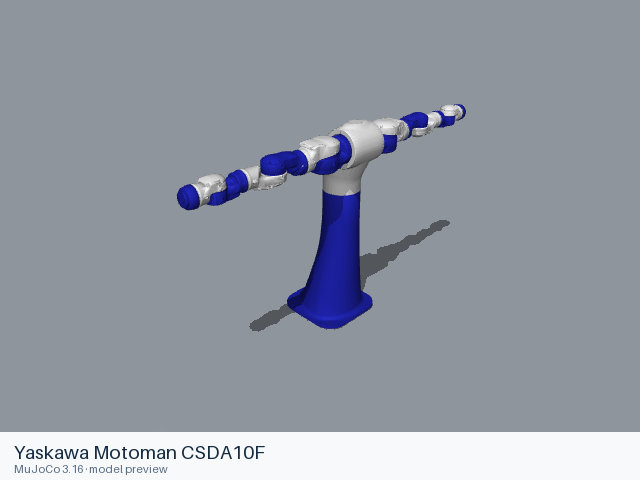](csda10f/README.md) | [Yaskawa Motoman CSDA10F](csda10f/README.md) | [URDF](csda10f/urdf/csda10f.urdf) | 15 | BSD-3-Clause |
| [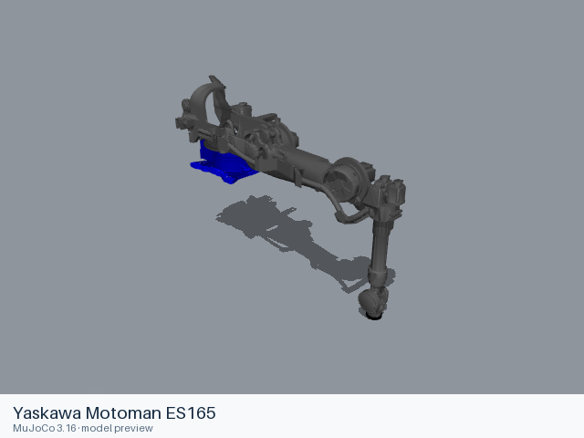](es165/README.md) | [Yaskawa Motoman ES165](es165/README.md) | [URDF](es165/urdf/es165.urdf) | 6 | Apache-2.0 |
| [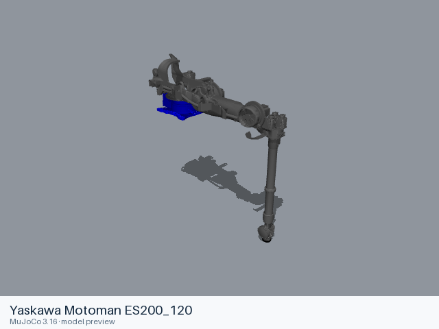](es200_120/README.md) | [Yaskawa Motoman ES200_120](es200_120/README.md) | [URDF](es200_120/urdf/es200_120.urdf) | 6 | Apache-2.0 |
| [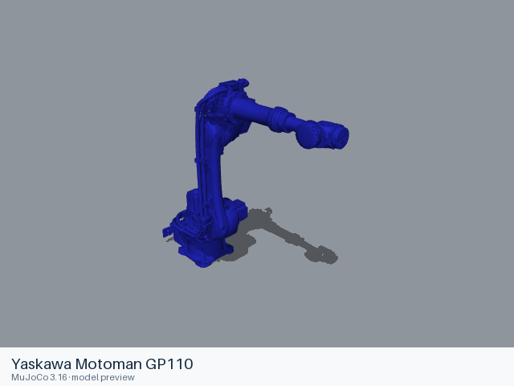](gp110/README.md) | [Yaskawa Motoman GP110](gp110/README.md) | [URDF](gp110/urdf/gp110.urdf) | 6 | BSD-3-Clause |
| [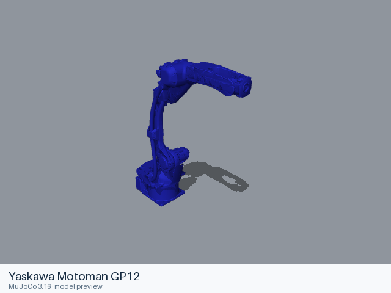](gp12/README.md) | [Yaskawa Motoman GP12](gp12/README.md) | [URDF](gp12/urdf/gp12.urdf) | 6 | BSD-3-Clause |
|  | [Yaskawa Motoman GP165R](gp165r/README.md) | [URDF](gp165r/urdf/gp165r.urdf) | 6 | BSD-3-Clause |
| [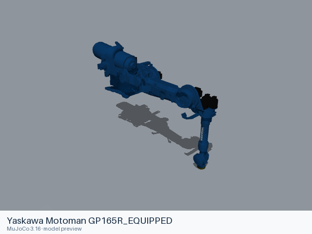](gp165r_equipped/README.md) | [Yaskawa Motoman GP165R_EQUIPPED](gp165r_equipped/README.md) | [URDF](gp165r_equipped/urdf/gp165r_equipped.urdf) | 6 | BSD-3-Clause |
| [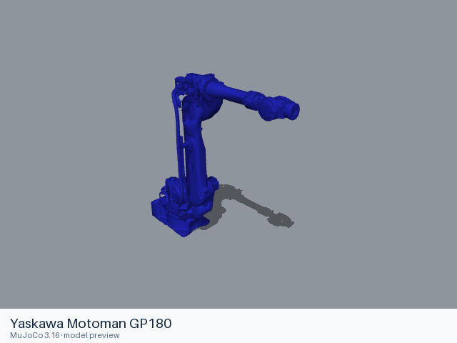](gp180/README.md) | [Yaskawa Motoman GP180](gp180/README.md) | [URDF](gp180/urdf/gp180.urdf) | 6 | BSD-3-Clause |
| [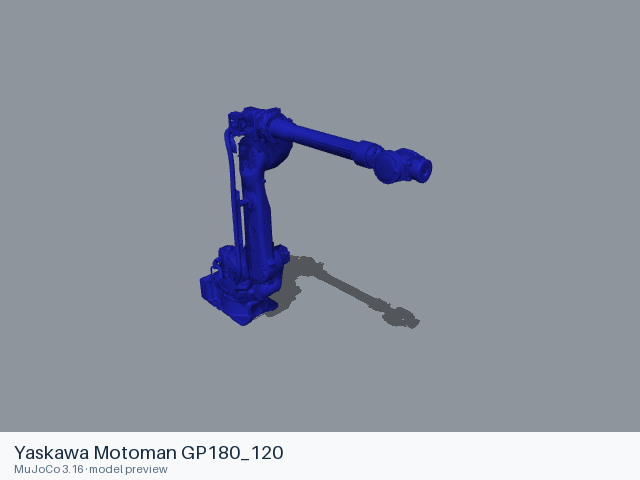](gp180_120/README.md) | [Yaskawa Motoman GP180_120](gp180_120/README.md) | [URDF](gp180_120/urdf/gp180_120.urdf) | 6 | BSD-3-Clause |
| [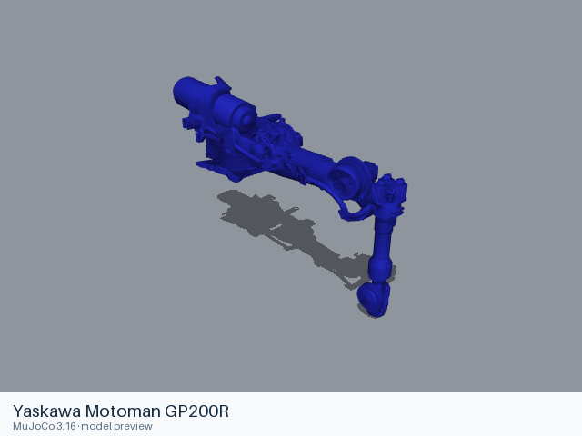](gp200r/README.md) | [Yaskawa Motoman GP200R](gp200r/README.md) | [URDF](gp200r/urdf/gp200r.urdf) | 6 | BSD-3-Clause |
| [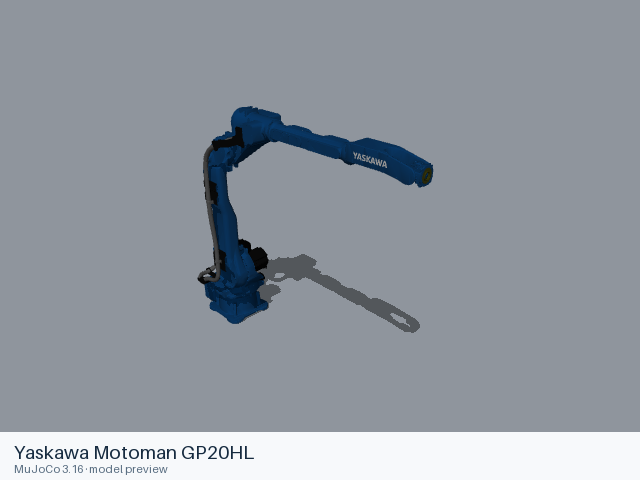](gp20hl/README.md) | [Yaskawa Motoman GP20HL](gp20hl/README.md) | [URDF](gp20hl/urdf/gp20hl.urdf) | 6 | BSD-3-Clause |
| [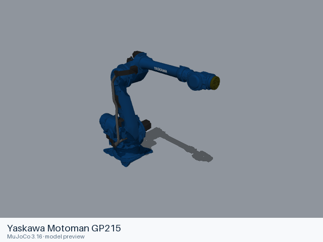](gp215/README.md) | [Yaskawa Motoman GP215](gp215/README.md) | [URDF](gp215/urdf/gp215.urdf) | 6 | BSD-3-Clause |
| [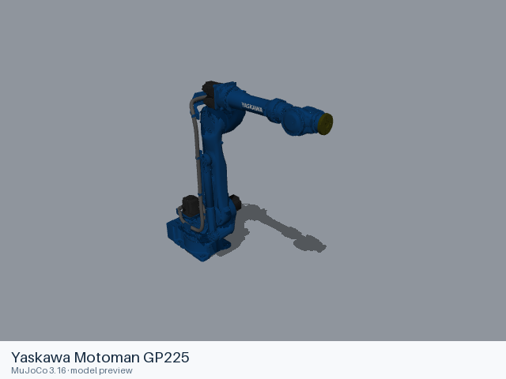](gp225/README.md) | [Yaskawa Motoman GP225](gp225/README.md) | [URDF](gp225/urdf/gp225.urdf) | 6 | BSD-3-Clause |
| [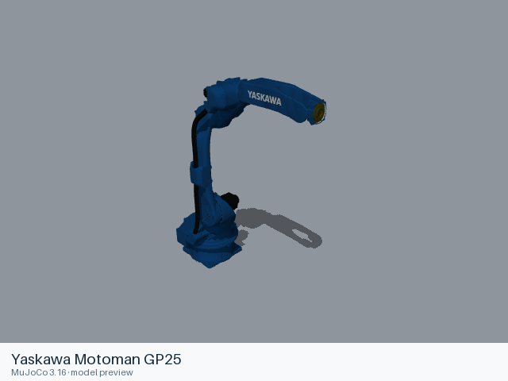](gp25/README.md) | [Yaskawa Motoman GP25](gp25/README.md) | [URDF](gp25/urdf/gp25.urdf) | 6 | BSD-3-Clause |
| [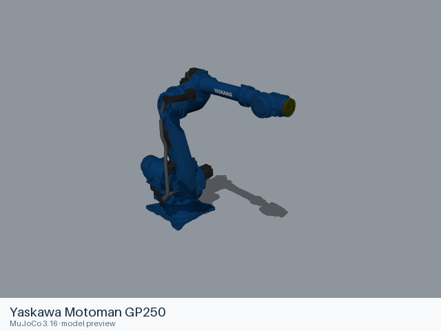](gp250/README.md) | [Yaskawa Motoman GP250](gp250/README.md) | [URDF](gp250/urdf/gp250.urdf) | 6 | BSD-3-Clause |
|  | [Yaskawa Motoman GP25_12](gp25_12/README.md) | [URDF](gp25_12/urdf/gp25_12.urdf) | 6 | BSD-3-Clause |
| [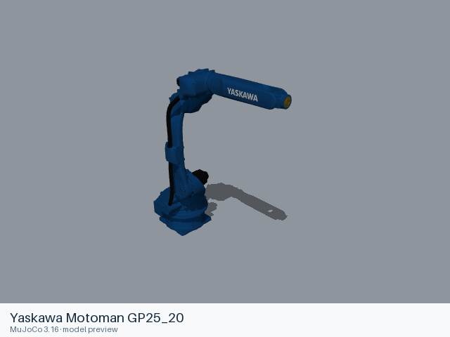](gp25_20/README.md) | [Yaskawa Motoman GP25_20](gp25_20/README.md) | [URDF](gp25_20/urdf/gp25_20.urdf) | 6 | BSD-3-Clause |
| [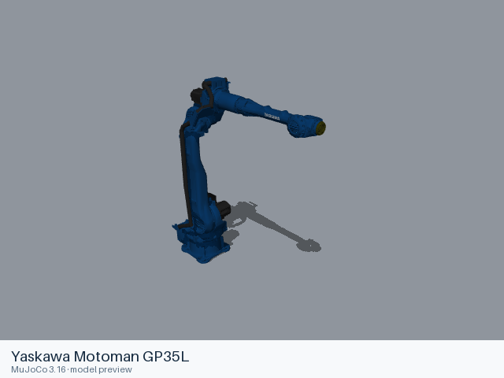](gp35l/README.md) | [Yaskawa Motoman GP35L](gp35l/README.md) | [URDF](gp35l/urdf/gp35l.urdf) | 6 | BSD-3-Clause |
| [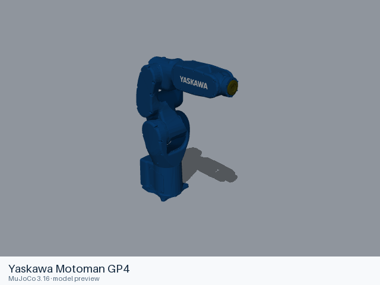](gp4/README.md) | [Yaskawa Motoman GP4](gp4/README.md) | [URDF](gp4/urdf/gp4.urdf) | 6 | BSD-3-Clause |
| [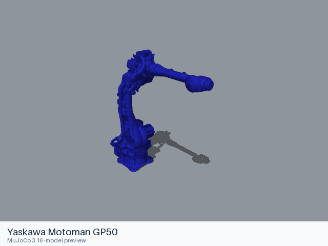](gp50/README.md) | [Yaskawa Motoman GP50](gp50/README.md) | [URDF](gp50/urdf/gp50.urdf) | 6 | BSD-3-Clause |
| [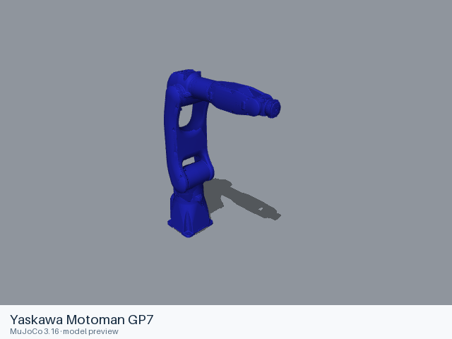](gp7/README.md) | [Yaskawa Motoman GP7](gp7/README.md) | [URDF](gp7/urdf/gp7.urdf) | 6 | BSD-3-Clause |
| [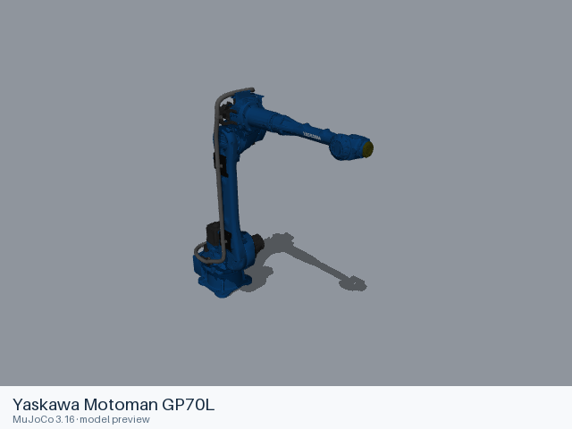](gp70l/README.md) | [Yaskawa Motoman GP70L](gp70l/README.md) | [URDF](gp70l/urdf/gp70l.urdf) | 6 | BSD-3-Clause |
| [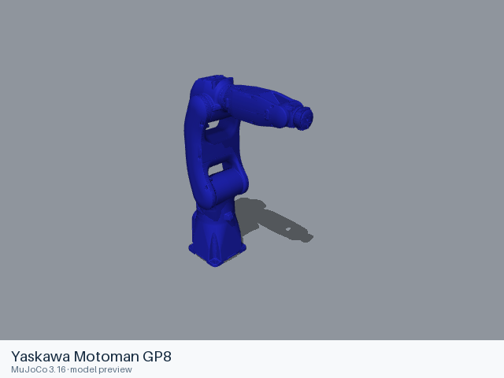](gp8/README.md) | [Yaskawa Motoman GP8](gp8/README.md) | [URDF](gp8/urdf/gp8.urdf) | 6 | BSD-3-Clause |
|  | [Yaskawa Motoman GP88](gp88/README.md) | [URDF](gp88/urdf/gp88.urdf) | 6 | BSD-3-Clause |
| [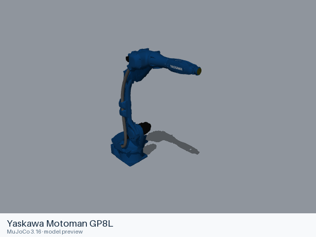](gp8l/README.md) | [Yaskawa Motoman GP8L](gp8l/README.md) | [URDF](gp8l/urdf/gp8l.urdf) | 6 | BSD-3-Clause |
| [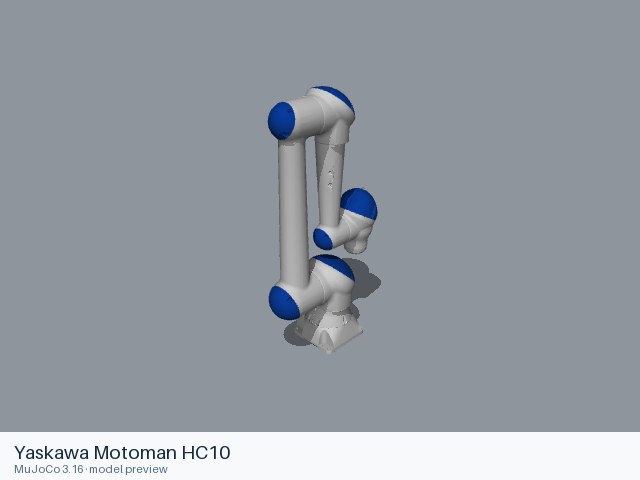](hc10/README.md) | [Yaskawa Motoman HC10](hc10/README.md) | [URDF](hc10/urdf/hc10.urdf) | 6 | BSD-3-Clause |
| [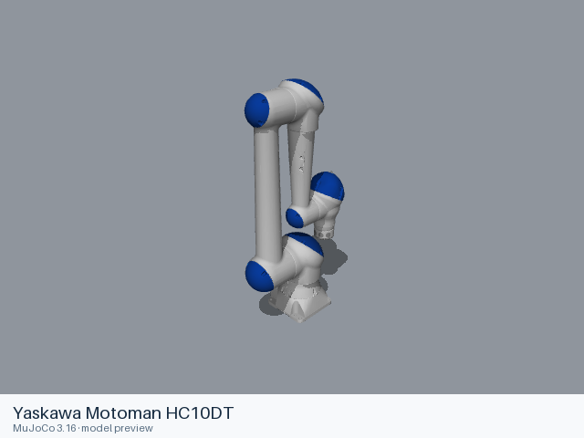](hc10dt/README.md) | [Yaskawa Motoman HC10DT](hc10dt/README.md) | [URDF](hc10dt/urdf/hc10dt.urdf) | 6 | BSD-3-Clause |
| [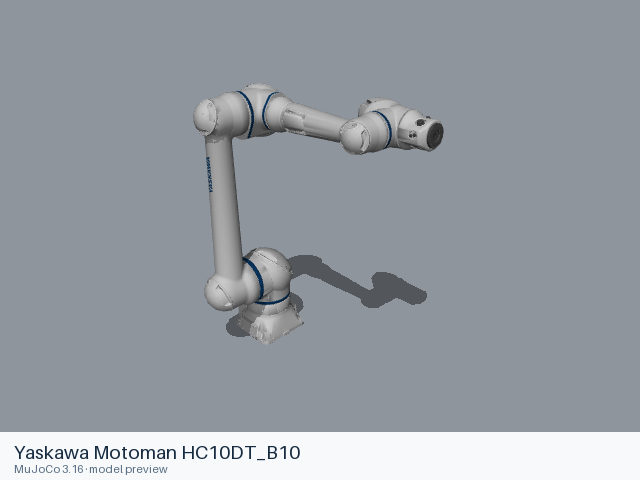](hc10dt_b10/README.md) | [Yaskawa Motoman HC10DT_B10](hc10dt_b10/README.md) | [URDF](hc10dt_b10/urdf/hc10dt_b10.urdf) | 6 | BSD-3-Clause |
| [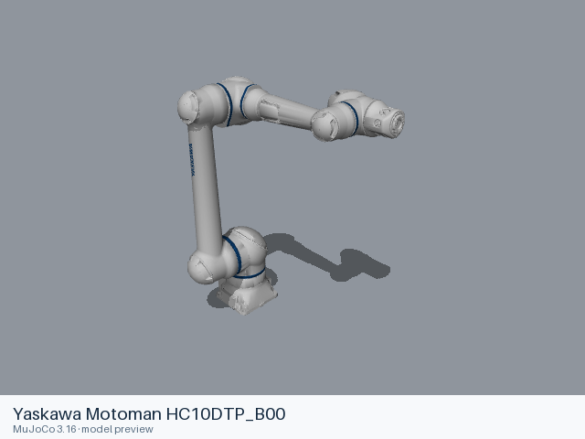](hc10dtp_b00/README.md) | [Yaskawa Motoman HC10DTP_B00](hc10dtp_b00/README.md) | [URDF](hc10dtp_b00/urdf/hc10dtp_b00.urdf) | 6 | BSD-3-Clause |
| [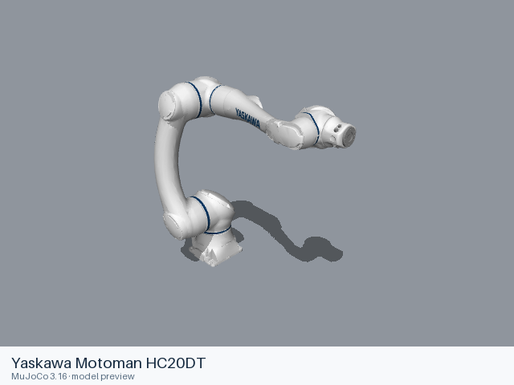](hc20dt/README.md) | [Yaskawa Motoman HC20DT](hc20dt/README.md) | [URDF](hc20dt/urdf/hc20dt.urdf) | 6 | BSD-3-Clause |
|  | [Yaskawa Motoman HC20DTP](hc20dtp/README.md) | [URDF](hc20dtp/urdf/hc20dtp.urdf) | 6 | BSD-3-Clause |
| [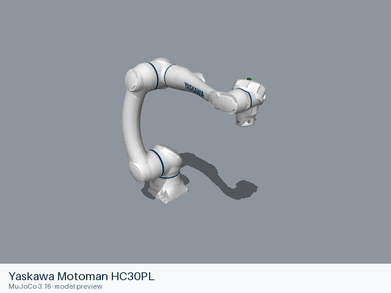](hc30pl/README.md) | [Yaskawa Motoman HC30PL](hc30pl/README.md) | [URDF](hc30pl/urdf/hc30pl.urdf) | 6 | BSD-3-Clause |
| [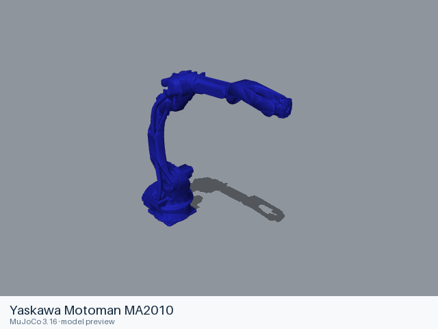](ma2010/README.md) | [Yaskawa Motoman MA2010](ma2010/README.md) | [URDF](ma2010/urdf/ma2010.urdf) | 6 | BSD-3-Clause |
|  | [Yaskawa Motoman MH110](mh110/README.md) | [URDF](mh110/urdf/mh110.urdf) | 6 | BSD-3-Clause |
|  | [Yaskawa Motoman MH12](mh12/README.md) | [URDF](mh12/urdf/mh12.urdf) | 6 | Apache-2.0 |
| [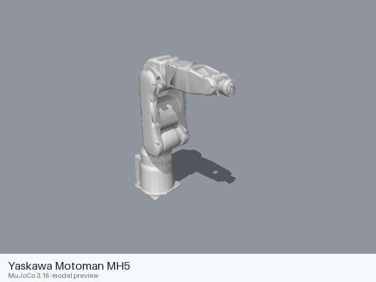](mh5/README.md) | [Yaskawa Motoman MH5](mh5/README.md) | [URDF](mh5/urdf/mh5.urdf) | 6 | BSD-3-Clause |
|  | [Yaskawa Motoman MH50](mh50/README.md) | [URDF](mh50/urdf/mh50.urdf) | 6 | BSD-3-Clause |
| [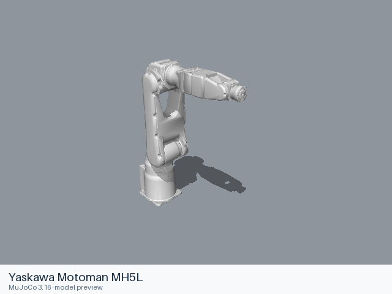](mh5l/README.md) | [Yaskawa Motoman MH5L](mh5l/README.md) | [URDF](mh5l/urdf/mh5l.urdf) | 6 | BSD-3-Clause |
| [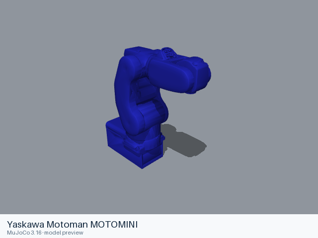](motomini/README.md) | [Yaskawa Motoman MOTOMINI](motomini/README.md) | [URDF](motomini/urdf/motomini.urdf) | 6 | BSD-3-Clause |
| [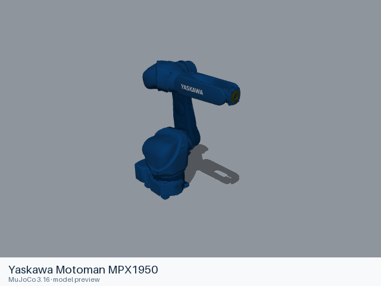](mpx1950/README.md) | [Yaskawa Motoman MPX1950](mpx1950/README.md) | [URDF](mpx1950/urdf/mpx1950.urdf) | 6 | BSD-3-Clause |
| [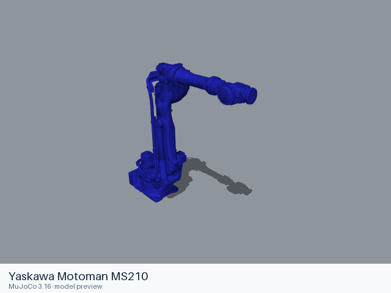](ms210/README.md) | [Yaskawa Motoman MS210](ms210/README.md) | [URDF](ms210/urdf/ms210.urdf) | 6 | BSD-3-Clause |
|  | [Yaskawa Motoman SDA10F](sda10f/README.md) | [URDF](sda10f/urdf/sda10f.urdf) | 15 | BSD-3-Clause |
| [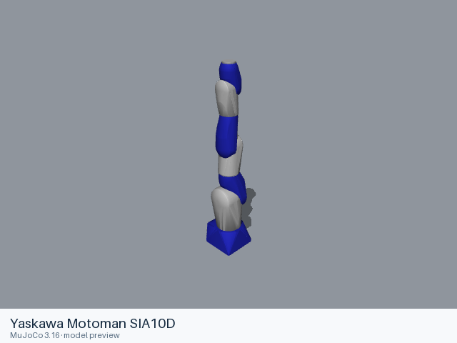](sia10d/README.md) | [Yaskawa Motoman SIA10D](sia10d/README.md) | [URDF](sia10d/urdf/sia10d.urdf) | 7 | BSD-3-Clause |
| [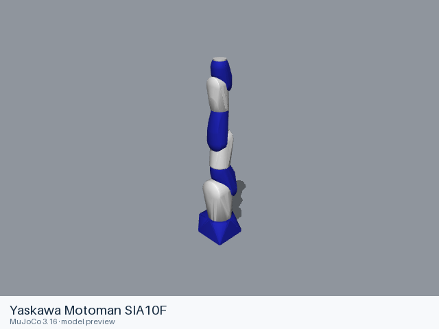](sia10f/README.md) | [Yaskawa Motoman SIA10F](sia10f/README.md) | [URDF](sia10f/urdf/sia10f.urdf) | 7 | BSD-3-Clause |
| [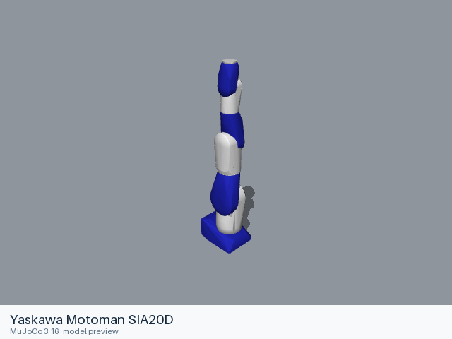](sia20d/README.md) | [Yaskawa Motoman SIA20D](sia20d/README.md) | [URDF](sia20d/urdf/sia20d.urdf) | 7 | BSD-3-Clause |
| [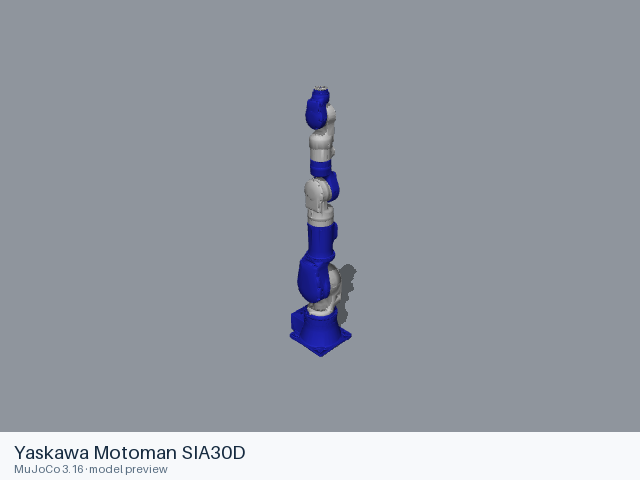](sia30d/README.md) | [Yaskawa Motoman SIA30D](sia30d/README.md) | [URDF](sia30d/urdf/sia30d.urdf) | 7 | BSD-3-Clause |
| [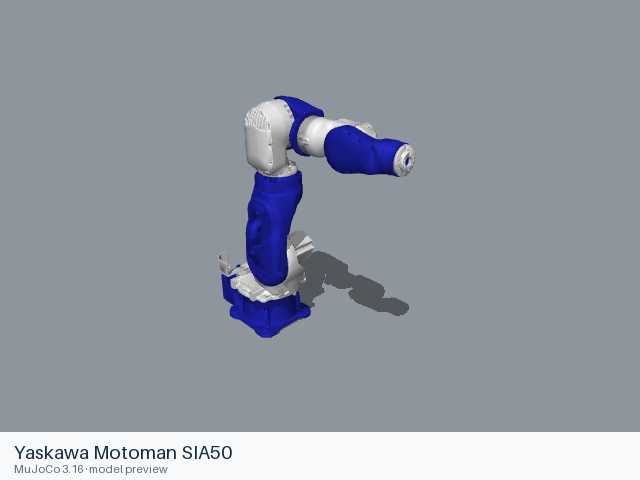](sia50/README.md) | [Yaskawa Motoman SIA50](sia50/README.md) | [URDF](sia50/urdf/sia50.urdf) | 7 | BSD-3-Clause |
| [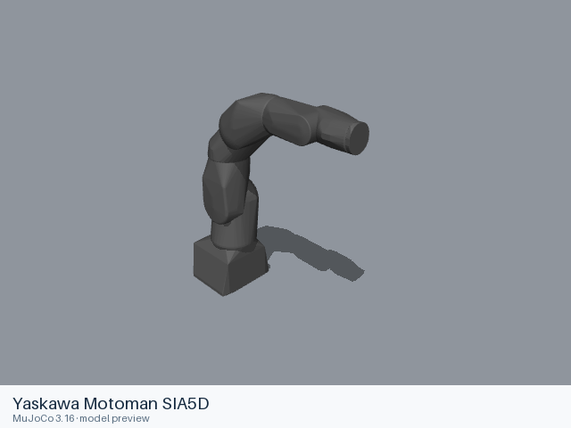](sia5d/README.md) | [Yaskawa Motoman SIA5D](sia5d/README.md) | [URDF](sia5d/urdf/sia5d.urdf) | 7 | BSD-3-Clause |
| [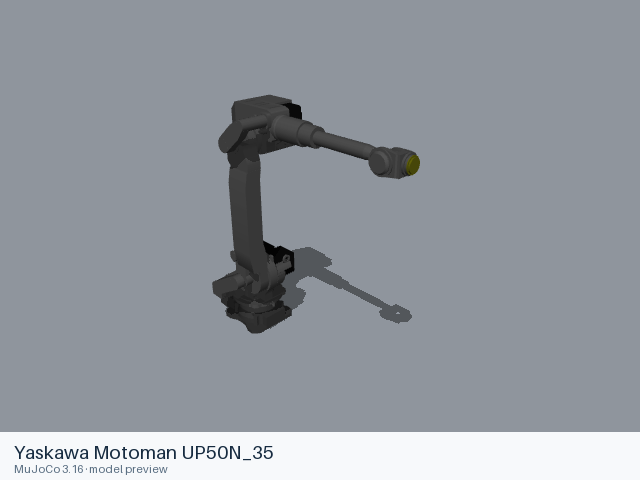](up50n_35/README.md) | [Yaskawa Motoman UP50N_35](up50n_35/README.md) | [URDF](up50n_35/urdf/up50n_35.urdf) | 6 | BSD-3-Clause |

## Known limitations

Loading support and physical-model limitations are recorded in each model README. The manufacturer name identifies the source hardware and upstream organization; inclusion here does not imply endorsement of this collection.

The upstream manifests identify contributions from ROS-Industrial developers as well as Yaskawa. This collection uses the Yaskawa-Global maintained ROS 2 repository and preserves each package manifest.
