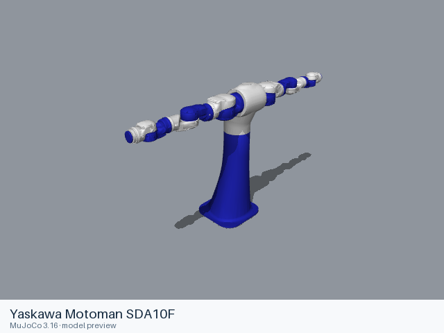

# Yaskawa Motoman SDA10F

[Manufacturer gallery](../README.md) · [All manufacturers](../../../README.md)



MuJoCo preview · [Rendering record](preview.json) · [Rendering method](../../../docs/PREVIEWS.md)

Yaskawa Motoman SDA10F, 15-joint dual-arm robot body, with no gripper. The model is supplied by the manufacturer's GitHub organization for use as a robot description in an existing scene.

## Model entries

Entry paths are relative to the repository root.

| Purpose / assembly | Format | Entry path | Target environment and required loading options |
|---|---|---|---|
| Dual-arm robot body, no gripper | URDF | [`models/yaskawa/sda10f/urdf/sda10f.urdf`](urdf/sda10f.urdf) | Native URDF loader; resolve resources relative to the entry file; use a fixed base for dynamics. |

## Mechanical information

| Item | Definition |
|---|---|
| Hardware revision and gripper | SDA10F — YR-SDA010F-A00, standard specification for FS100; two 7-joint arms and one independent torso axis; no gripper |
| Units | URDF: metres, kilograms, radians, seconds; mesh scale factors remain explicit in the entry |
| Base | `base_link`; `torso_base_link` is attached by `base_link_to_torso_base_link` (xyz = `0 0 1.2` m, rpy = `0 0 0` rad) |
| Arm joint order | `group_3/joint_1` (revolute), `group_1/joint_1` (revolute), `group_1/joint_2` (revolute), `group_1/joint_3` (revolute), `group_1/joint_4` (revolute), `group_1/joint_5` (revolute), `group_1/joint_6` (revolute), `group_1/joint_7` (revolute), `group_2/joint_1` (revolute), `group_2/joint_2` (revolute), `group_2/joint_3` (revolute), `group_2/joint_4` (revolute), `group_2/joint_5` (revolute), `group_2/joint_6` (revolute), `group_2/joint_7` (revolute) |
| Passive relationships | `group_4/joint_1` = 1 × `group_3/joint_1` + 0 |
| Gripper | None |
| End effector / TCP | `group_1/tool0`; `group_2/tool0`. Fixed frame transforms: `group_1/link_7` → `group_1/tool0`: xyz = `0 0 0` m, rpy = `0 0 3.141592653589793` rad; `group_2/link_7` → `group_2/tool0`: xyz = `0 0 0` m, rpy = `0 0 3.141592653589793` rad |
| Included poses | No named poses are stored in this URDF. |

## Loading example

```python
from yourdfpy import URDF

robot = URDF.load(
    '/absolute/path/to/awesome-robot-arm-zoo/models/yaskawa/sda10f/urdf/sda10f.urdf',
    load_meshes=True, load_collision_meshes=True,
    build_collision_scene_graph=True,
)
```

## Sources and licensing

| Format or file scope | Upstream project | Version | Upstream file path | License file |
|---|---|---|---|---|
| URDF definition and companion meshes | [Yaskawa-Global/motoman_ros2_support_packages](https://github.com/Yaskawa-Global/motoman_ros2_support_packages) — manufacturer-maintained | `a77f186048bd3c35fc3bb5142f9d9270dbebe69f` | [`motoman_sda10f_support/urdf/sda10f.xacro`](https://github.com/Yaskawa-Global/motoman_ros2_support_packages/blob/a77f186048bd3c35fc3bb5142f9d9270dbebe69f/motoman_sda10f_support/urdf/sda10f.xacro); `motoman_sda10f_support/meshes/` | [BSD-3-Clause](urdf/LICENSE) |
| Upstream package metadata | Same project | Same commit | `motoman_sda10f_support/package.xml` | [Preserved manifest](urdf/source_package.xml) |
| Common material and color definitions | Same project | Same commit | `motoman_resources/urdf/common_materials.xacro`; `motoman_resources/urdf/common_colors.xacro` | [BSD-3-Clause](urdf/LICENSE); [manifest](urdf/common_resources_package.xml) |

The package license declaration applies to the robot description and accompanying mesh resources. Upstream copyright and author notices are retained in the entry, package metadata and accompanying notice files. This collection preserves those source terms for the included files.

## Model preparation

Static URDF expanded from the upstream Xacro with xacro 2.1.1 using the upstream top-level defaults. Resource filenames resolve relative to the URDF file. The source mesh hierarchy is retained under `urdf/resources/`. Links, joint transforms, limits, mesh scales, inertial properties and collision definitions retain the upstream values.

## Loading verification

Checks performed on 2026-10-15. The complete format directory was copied to a temporary location and loaded by absolute path from a separate working directory.

| Entry | Environment and loader version | Verification steps | Result |
|---|---|---|---|
| `models/yaskawa/sda10f/urdf/sda10f.urdf` | macOS 27.2, arm64, Python 3.12.14; yourdfpy 0.0.60 | Load visual/collision geometry and update the joint configuration. | Passed, including resource relocation. |

## Known limitations

Dynamic task execution, controller performance and training behavior have not been validated.

- The upstream model omits inertial definitions for 16 geometry-bearing link(s); dynamics engines may supply their own defaults.
- Upstream package manifests declare BSD-3-Clause. The repository has no standalone license file; the included LICENSE supplies the standard BSD-3-Clause terms and source_package.xml retains the upstream author and license declarations. Common material definitions are BSD-3-Clause as declared in common_resources_package.xml.
- Robot controllers, hardware drivers, calibrated tools and simulator-specific actuation are configured by the consuming project. Other simulator environments have not been tested.
